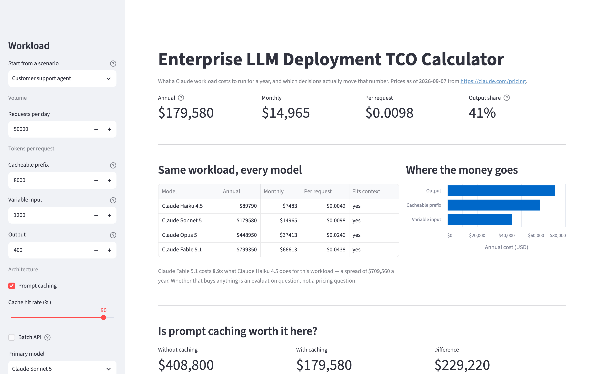
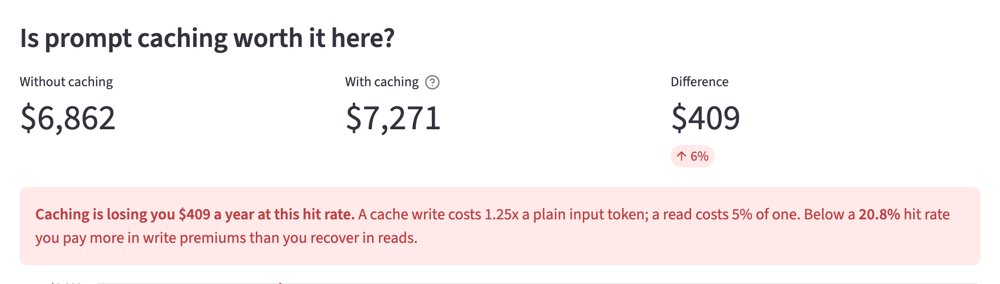
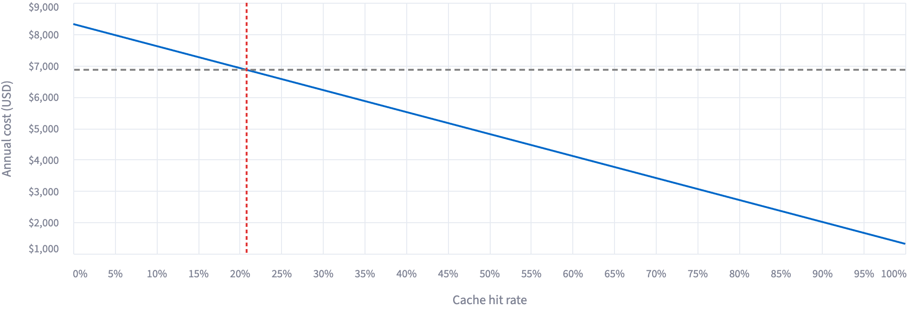
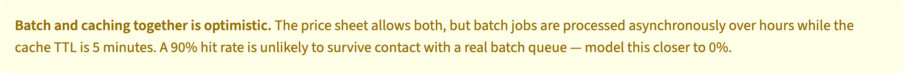

# Enterprise LLM Deployment TCO Calculator

**What a Claude workload actually costs to run for a year — and which architectural decisions move that number.**

**▶ [Try it live](https://llm-tco-calculator.streamlit.app/)** — no install; the
three findings below each load the scenario that shows them.

Most cost calculators multiply tokens by a price. That is the easy half. The
useful half is knowing which levers are real, which are marginal, and which
ones quietly make the bill *bigger* — and that is what this tool is built to
answer.



---

## Three things the model surfaces that are easy to get wrong

Each one is a card on the app's first screen, and each card loads the scenario
that demonstrates it — the argument should not live only in this README while
the deployed app shows a bare calculator.

### 1. Prompt caching costs you money below a ~20% hit rate, whatever the read discount

Caching is usually sold as "90% off your input tokens." That is true of a cache
*read*. But a cache *write* costs **1.25× a plain input token**, and every miss
is a write. So caching is a bet on your hit rate, and the bet has a breakeven:

```
h · cache_read + (1 − h) · cache_write = input
```

| Model | Cache read | Breakeven hit rate |
|---|---|---|
| Claude Haiku 4.5 | 10% of input | **21.7%** |
| Claude Sonnet 5.5 | 10% of input | **21.7%** |
| Claude Opus 5.5 | 5% of input | **20.8%** |
| Claude Fable 5.1 | 2.5% of input | **20.4%** |

Below that line, turning caching on makes the bill larger.

The interesting part is how little the read discount moves it. Opus 5.5 reads at
5% of input — twice as good a discount as Sonnet 5.5's 10% — and buys less than
a single percentage point of breakeven. Hold the write premium at 1.25× and let
the read price fall all the way to zero, and the breakeven converges on

```
h → 0.25 / 1.25 = 20%
```

**So there is a floor at roughly 20%, and it is set entirely by the write
premium.** Even a free cache read would not move it. Every "90% off" headline
describes the half of the mechanism that turns out not to govern the decision.

This matters most exactly where people reach for caching first: **low-volume
pilots**. A 200-request/day pilot on Opus 5.5 with a 20K-token prefix and a 15%
hit rate costs **\$7,271/year with caching on versus \$6,862 with it off** — the
optimisation loses \$409 a year. The `low_volume_pilot` preset in the app
reproduces this.



The app plots cost against hit rate with the breakeven marked, so you can see
the whole region where the optimisation is negative rather than trusting a
single number.



The blue line crosses the grey no-caching baseline exactly at the red breakeven
marker. Everything to the left of it is a region where the optimisation is
negative — and a 15% hit rate is not an unusual place for a pilot to sit.

### 2. Even a great cache hit rate is not a great discount

Caching only touches the cacheable prefix. It cannot touch output, and output
is priced at 5× input.

Take the `coding_agent` preset — a 30K-token repo context re-read every turn,
6K tokens of generation, on Opus 5.5:

| Component | Annual |
|---|---|
| Cacheable prefix (30K tokens) | \$87,600 |
| Variable input (3K tokens) | \$8,760 |
| Output (6K tokens) | \$87,600 |

A **90% hit rate on that prefix cuts the total bill by 40%, not 90%.** And note
the first and last rows: 6K tokens of output cost exactly as much as a 30K-token
prefix re-read on every single turn. On output-heavy agent workloads, capping
generation length is a bigger lever than caching — and it is the lever nobody
puts in the architecture diagram.

### 3. The Batch API is the largest single lever, and it costs only latency

A flat 50% off input and output. On the `document_processing` preset — 20K
nightly extractions on Sonnet 5.5 — that is **\$306,600 → \$153,300, a \$153,300
annual saving** for work nobody is waiting on.

The question is never "can we afford it." It is "does anyone need this answer
in under an hour." For overnight extraction, reporting, and back-catalogue
processing the answer is usually no, and the discount is free.

**One caveat the price sheet will not tell you:** batch and caching are both
listed as available, but batch jobs are processed asynchronously over hours
while the cache TTL is five minutes. Modelling a high hit rate on batched
traffic produces a number that will not survive contact with production. The
app warns when you combine them.



---

## Running it

The deployed copy is at **<https://llm-tco-calculator.streamlit.app/>**, built
from `main` on Python 3.13. To run it locally instead:

```bash
python3 -m venv .venv && source .venv/bin/activate
pip install -r requirements.txt
streamlit run app.py
```

Dependencies are pinned exactly rather than given as ranges, for the same
reason `pricing.py` records a retrieval date: a tool whose claim is that its
numbers are reproducible should not hand its own runtime to whatever resolves
on the day of the build.

Tests:

```bash
pip install -r requirements-dev.txt
pytest
```

---

## How the model works

A workload is described the way a customer describes one — volume, token
shape, and architecture — and priced over a year.

| Input | Meaning |
|---|---|
| Requests per day | Production volume |
| Cacheable prefix | The stable head of every request: system prompt, tool definitions, policy documents. The only part caching can help. |
| Variable input | The part that differs per request: the user's question, retrieved chunks. Never cacheable. |
| Output | Generated tokens. Priced ~5× input. |
| Cache hit rate | What fraction of requests find a warm cache |
| Batch API | Whether the work tolerates asynchronous processing |

Each token field restates itself in words and pages underneath, because nobody
arrives at a pricing conversation knowing their prompt in tokens — they know it
as "our claims policy, about forty pages." Without that bridge the form is only
fillable by people who already have the answer, which is the wrong audience for
a pre-sales tool. The conversion is a ratio, not a tokenizer, and it differs by
model generation; the app says so.

The split between cacheable prefix and variable input is the design decision
that makes the rest work. Collapsing them into one "input tokens" field — which
is what most calculators do — makes it impossible to model caching honestly,
because you can no longer tell which tokens are eligible.

**Layout:**

| File | Role |
|---|---|
| `pricing.py` | Every dollar figure in the project, with source URL and retrieval date |
| `tco.py` | The cost model. Pure functions, no UI imports. |
| `app.py` | Streamlit rendering only |
| `test_tco.py` | Pins the claims this README makes |
| `scripts/make_screenshots.py` | Regenerates the images above, so they cannot drift from the code |

The tests are not there for regression safety on a 200-line model. They are
there so that if the breakeven figure or the caching-trap example stops being
true, a test fails instead of this README quietly becoming wrong.

---

## Pricing data

Dollar figures from **<https://claude.com/pricing>**; context windows from the
**<https://platform.claude.com/docs/en/about-claude/models/overview>**, which is
where they are actually published. Both retrieved **2026-10-05** and recorded in
`pricing.py` alongside the date they were read.

The lineup here is the one the pricing page lists as current. Opus 5 and
Sonnet 5 moved to its legacy section on 2026-10-05 and are no longer carried.

Prices change. A cost model that does not say when its numbers were taken is
not a cost model, it is a screenshot. If the retrieval date above is old,
re-read the source before quoting anything here to a customer.

---

## What this deliberately does not model

Being explicit about the edges is part of the deliverable — an estimate whose
limits are unstated is not usable in a procurement conversation.

- **Retries and failures.** Routinely 5–15% on top in production.
- **Evaluation and monitoring traffic.** Often material, and always forgotten.
- **The 1-hour cache TTL**, which is priced above the 5-minute rate — and which
  is the real answer to the batch-plus-caching problem above, since an hour may
  outlive a batch queue where five minutes will not.
- **Fast mode**, priced at 2x standard on the Opus line. It is the other end of
  the latency-versus-cost axis from the Batch API, and this model prices only
  one end of it.
- **Tokenizer differences between model generations.** The same text is not the
  same token count on every model, so a cross-generation comparison of `$/MTok`
  alone is misleading. Count tokens on both before trusting a delta.
- **Everything that is not inference:** vector storage, orchestration, egress,
  and the engineering time to run any of it.
- **Whether the cheaper model is good enough.** This tool prices the models; it
  cannot tell you which one clears your quality bar. That is an evaluation
  question, and it is the one that should be answered first.

---

## Notes

Built with Claude Code. Every figure in this README is derived from the code
and pinned by a test — see `test_tco.py`.
